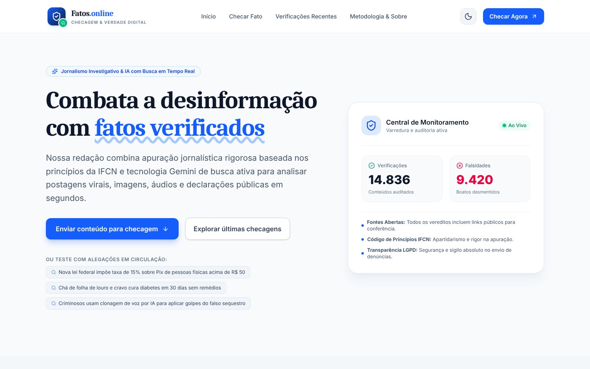
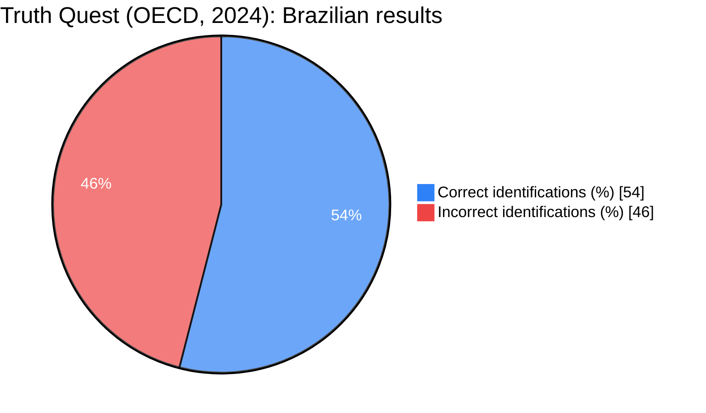
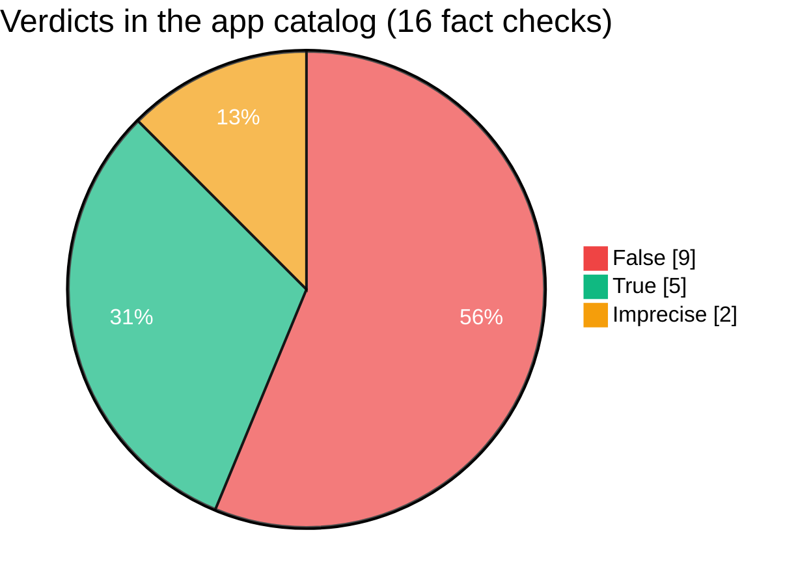
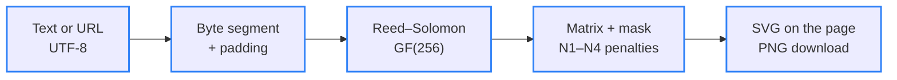

<div align="center">

# 🛡️ Fatos.online

> 🌐 Leia em [Português](./README.md)

[](#-how-it-works)

[](#️-technologies-used)

[](./LICENSE)
[](#-team)
[](#-page-map)
[](#-fact-checking-app)

`Landing: HTML · CSS · Vanilla JS · App: React · Express · Gemini · Apache-2.0`

</div>

**Fatos.online — Checagem & Verdade Digital** (Fact-Checking & Digital Truth) is an academic group project that fights misinformation with transparent fact-checking, academic references and media literacy. The repository holds the static **landing page** (root, no frameworks and no build step) and the full-stack AI **fact-checking app** (`app/` folder). The content is in Brazilian Portuguese.

---

## 📑 Table of Contents

- [🗂️ Project Structure](#️-project-structure)
- [🗂️ Project Structure - tree](#️-project-structure---tree)
- [👥 Team](#-team)
- [🖼️ Preview](#️-preview)
- [🧭 Page map](#-page-map)
- [🧩 Fact-checking app](#-fact-checking-app)
- [📡 API endpoints](#-api-endpoints)
- [📦 The dataset](#-the-dataset)
- [📊 Charts](#-charts)
- [🔄 How it works](#-how-it-works)
- [🔎 Checar Fato tool](#-checar-fato-tool)
- [📚 References](#-references)
- [⚙️ Technologies used](#️-technologies-used)
- [🚀 How to run](#-how-to-run)
- [✨ Features](#-features)
- [🤝 Contributing](#-contributing)
- [📄 License](#-license)

---

## 🗂️ Project Structure

| Path | Description |
|---|---|
| `index.html` | Landing page: header, hero with the Monitoring Center, the Checar Fato tool, the 6 content sections and a footer with the team. Holds the metadata (`author`, Dublin Core, Open Graph and JSON-LD listing the 10 members) and the icon sprite |
| `css/styles.css` | Dark and light theme tokens, frosted glass (glassmorphism), fluid typography with `clamp()` and breakpoints from 1280 px down to 360 px |
| `js/main.js` | Landing interactions: theme, mobile menu, active-section highlight, panel with animated counters, Checar Fato signal analysis, reference copying and the QR Code UI |
| `js/qrcode.js` | In-house QR Code generator (ISO/IEC 18004): UTF-8 byte mode, L/M/Q/H error correction, versions 1–40, Reed–Solomon and automatic mask selection; exports SVG and PNG |
| `app/` | Full-stack fact-checking app exported from Google AI Studio: React + Vite + Tailwind front end and an Express server using the Gemini API |
| `app/server/` | `gemini.ts` (AI checking, live search and the fallback evidence evaluator), `routes.ts` (6 API routes) and `storage.ts` (JSON persistence) |
| `app/src/` | React UI: `App.tsx`, 9 components (`Hero`, `FactChecker`, `MediaUploader`, `RadarSection`, `RecentChecks`, `Newsletter`, `AboutMethodology`, `Header`, `Footer`) and shared types |
| `app/.data/fact_checks.json` | Fact-check catalog served by the API (16 records) |
| `app/db/schema.sql` | Equivalent relational schema (PostgreSQL/SQLite) for the newsletter and fact checks |
| `app/.env.example` | Environment variables template (`GEMINI_API_KEY`, `APP_URL`) |
| `app/.aistudio/` | Implementation plan generated in Google AI Studio |
| `assets/fonts/` | Merriweather 700 and Plus Jakarta Sans (variable) as WOFF2, self-hosted in the project |
| `assets/licenses/` | Licenses for the fonts (SIL OFL 1.1) and the Lucide icons (ISC) |
| `assets/favicon.svg` | Shield icon with a verification badge, same as the brand mark |
| `docs/` | Real screenshots of the landing (1440×900 and 390×844) and of the app (1440×900) |
| `humans.txt` | Team credits |
| `_config.yml` | GitHub Pages configuration: publishes only the landing and leaves `app/` out |
| `LICENSE` | Full text of the Apache-2.0 license |
| `README.md` | This documentation in Portuguese |

---

## 🗂️ Project Structure - tree

```
🗂️
├── 📁 app
│  ├── 📁 .aistudio
│  │  └── … (2 files)
│  ├── 📁 .data
│  │  └── 📈 fact_checks.json
│  ├── 📁 db
│  │  └── 📈 schema.sql
│  ├── 📁 server
│  │  ├── ⚙️ gemini.ts
│  │  ├── ⚙️ routes.ts
│  │  └── ⚙️ storage.ts
│  ├── 📁 src
│  │  ├── 📁 components
│  │  │  └── … (9 files)
│  │  ├── 📁 types
│  │  │  └── ⚙️ index.ts
│  │  ├── ⚙️ App.tsx
│  │  ├── 🎨 index.css
│  │  └── ⚙️ main.tsx
│  ├── 🔧 .env.example
│  ├── 🔧 .gitignore
│  ├── 🌐 index.html
│  ├── 🔧 metadata.json
│  ├── 📦 package-lock.json
│  ├── 📦 package.json
│  ├── 📄 README.md
│  ├── ⚙️ server.ts
│  ├── 🔧 tsconfig.json
│  └── 🔧 vite.config.ts
├── 📁 assets
│  ├── 📁 fonts
│  │  ├── 📄 merriweather-latin-700-normal.woff2
│  │  └── 📄 plus-jakarta-sans-latin-wght-normal.woff2
│  ├── 📁 licenses
│  │  ├── 🗒️ LICENSE-Lucide.txt
│  │  ├── 🗒️ LICENSE-Merriweather.txt
│  │  └── 🗒️ LICENSE-PlusJakartaSans.txt
│  └── 🖼️ favicon.svg
├── 📁 css
│  └── 🎨 styles.css
├── 📁 docs
│  ├── 🖼️ preview-app.jpg
│  ├── 🖼️ preview-desktop.jpg
│  └── 🖼️ preview-mobile.jpg
├── 📁 js
│  ├── ⚙️ main.js
│  └── ⚙️ qrcode.js
├── 🔧 .gitignore
├── 🔧 _config.yml
├── 📄 humans.txt
├── 🌐 index.html
├── 🗒️ LICENSE
├── 🇺🇸 README.en.md
└── 🇧🇷 README.md
```

---

## 👥 Team

Academic group project. Members in alphabetical order of GitHub username:

<table>
  <tr>
    <td align="center"><a href="https://github.com/Andersmatias9278-hub"><br><sub><b>Andersmatias9278-hub</b></sub></a></td>
    <td align="center"><a href="https://github.com/briandevbr"><br><sub><b>David Brian</b><br>@briandevbr</sub></a></td>
    <td align="center"><a href="https://github.com/Davipcarvalh0"><br><sub><b>Davi P. Carvalho</b><br>@Davipcarvalh0</sub></a></td>
    <td align="center"><a href="https://github.com/GabrielleSophia"><br><sub><b>GabrielleSophia</b></sub></a></td>
    <td align="center"><a href="https://github.com/JoaoCGjr"><br><sub><b>JoaoCGjr</b></sub></a></td>
  </tr>
  <tr>
    <td align="center"><a href="https://github.com/larpras"><br><sub><b>larpras</b></sub></a></td>
    <td align="center"><a href="https://github.com/lucianohvn"><br><sub><b>Luciano</b><br>@lucianohvn</sub></a></td>
    <td align="center"><a href="https://github.com/luferc1"><br><sub><b>lucasmacedo</b><br>@luferc1</sub></a></td>
    <td align="center"><a href="https://github.com/matheuseduardo-cpu"><br><sub><b>matheuseduardo-cpu</b></sub></a></td>
    <td align="center"><a href="https://github.com/Victoriabueno22"><br><sub><b>Victoriabueno22</b></sub></a></td>
  </tr>
</table>

<sub>GitHub's “Contributors” sidebar only lists people who have committed; this is the full team.</sub>

---

## 🖼️ Preview

<div align="center">
  
  
</div>

<div align="center">
  
</div>

<sub>Real screenshots: landing in the dark theme (1440×900 and 390×844) and the app running locally in the light theme (1440×900).</sub>

---

## 🧭 Page map

| Section | Anchor | What it has |
|---|---|---|
| Início (Home) | `#inicio` | Badge, headline, calls to action and the Monitoring Center (a demo panel with simulated numbers, labeled as such) |
| Checar Fato (Fact check) | `#checar` | Local analysis of 8 warning signs, ready-made searches in fact-checking databases and a pointer to the full app in `app/` |
| 01 · The Disinformation Ecosystem and the Role of the Repository | `#sobre` | Information disorder, engagement algorithms, the role of AI and the pillars Methodological Transparency, Reproducibility and Knowledge Centralization |
| 02 · The Cross-Cutting Impact of Fake News on Society | `#impacto` | Democratic erosion and polarization; public health and science (OECD Truth Quest and the Ciência UFPR study); individual harm and collective violence |
| 03 · Complementary Coping Strategies | `#metodologia` | Technology and metrics (NLP, data scraping), IFCN-standard fact-checking with a 5-step workflow and a verdict scale, media and digital literacy |
| 04 · Practical Fact-Checking Cases | `#verificacoes` | Electric car batteries (False) and insomnia, brain waves and Alzheimer's (Misleading), with sources |
| 05 · Academic References | `#referencias` | 11 references in ABNT format, copied one by one or all at once |
| 06 · Connectivity & Quick Access | `#acesso` | QR Code generated in the browser, with PNG download, link copying and sharing |
| Equipe do projeto (Project team) | `#equipe` | The 10 members, with avatar and link to their GitHub profile |

The top menu follows the visual reference: **Início**, **Checar Fato**, **Verificações Recentes** and **Metodologia & Sobre** (which covers sections 01 to 03).

---

## 🧩 Fact-checking app

The `app/` folder holds the full app exported from [Google AI Studio](https://aistudio.google.com/): the user submits a text, link, image or video; the server searches recent news, asks Gemini and returns a verdict (`verdadeiro`, `falso`, `impreciso` or `nao_verificavel`) with confidence, explanation and sources. It also has a filterable fact-check catalog, a trends radar and a newsletter with LGPD consent.

Changes made during the integration so the app installs, compiles and answers correctly:

- `package.json`: `esbuild` bumped from `^0.25.0` to `^0.28.0` — the original version conflicted with Vite 8 and `npm install` failed; it also got a name (`fatos-online-app`) and the `license` field.
- `server/gemini.ts`: the evidence evaluator used when Gemini doesn't answer received its arguments in the wrong order (an error reported by `npm run lint`) and crashed; it now returns a verdict based on the articles found.
- `src/components/Footer.tsx`: “Todos os direitos reservados” (all rights reserved) became a credit to the team and the Apache-2.0 license.
- `.gitignore`: the newsletter subscriber list (`.data/subscribers.json`) is not versioned, since it is personal data; the app recreates the file on startup.

---

## 📡 API endpoints

| Method | Route | What it does |
|---|---|---|
| `GET` | `/api/health` | Checks that the server is up |
| `POST` | `/api/fact-check` | Checks a piece of content (`text`, `link` or base64 media) and saves the result to the catalog |
| `POST` | `/api/newsletter` | Subscribes to the newsletter (requires `email` and LGPD consent) |
| `GET` | `/api/recent-checks` | Lists fact checks, with `category`, `search` and `limit` filters |
| `GET` | `/api/stats` | Totals shown on the app's panel |
| `GET` | `/api/radar-trends` | Claims in circulation, via Gemini with Google Search |

Real `GET /api/health` response with the server running locally:

```json
{"status":"online","service":"Fatos.online Fact-Checking API","timestamp":"2026-10-22T17:05:50.201Z"}
```

---

## 📦 The dataset

| Item | Detail |
|---|---|
| File | `app/.data/fact_checks.json` — read and updated by `server/storage.ts` |
| Content | Fact checks with claim, category, verdict, confidence (0–100), explanation, key points and sources |
| Coverage | 16 records: 6 seed examples and 10 checks generated by the AI during testing |
| Verdicts | 9 false, 5 true and 2 imprecise |
| Categories | Politics (8), Health & Science (5), Technology & AI (2), Social Media & Scams (1) |
| Period | October 19 to 22, 2026 |
| Format | JSON (UTF-8), one object per fact check |
| Quirks | Two test-generated checks were removed during the integration because they gave a wrong verdict on the false “15% Pix tax” claim (one rated it true). The three checks on the “taxa das blusinhas” (tax on small imports) cite articles about the end of the tax as confirmation and still need human review. The `/api/stats` totals (e.g. 14,836 checks) add a fixed base of 14,820 set in the code and are for demonstration only |

---

## 📊 Charts



<sub>Source: [The OECD Truth Quest Survey](https://doi.org/10.1787/92a94c0f-en) (Lesher; Pawelec; Fogarassy, 2024). Brazil ranked last among 21 countries; the overall average was 60%.</sub>



<sub>Source: count of `app/.data/fact_checks.json` — see the notes in [The dataset](#-the-dataset).</sub>

---

## 🔄 How it works



<sub>Blue border = step implemented in `js/qrcode.js`</sub>

The landing's generator picks the smallest QR Code version that fits the content, raises the error-correction level while there is still room in that same version, and tries all 8 masks defined by the standard, keeping the one with the lowest penalty. Everything runs in the browser: the link is never sent to an external service.

```text
Input:             https://briandevbr.github.io/fatos.online/   (42 bytes)
External API:        sends the link to third parties and fails offline   ❌
FatosQR.encode():  version 3 · correction M · mask 1 · 29×29 modules                                  ✅
```

When the page is opened locally (`file://` or `localhost`), the QR Code points to the public address `https://briandevbr.github.io/fatos.online/`, since a phone cannot reach the local machine.

---

## 🔎 Checar Fato tool

The landing's tool does not decide whether something is true: it flags language patterns common in hoaxes and builds searches on [Google Fact Check Explorer](https://toolbox.google.com/factcheck/explorer), Brazilian fact-checking agencies and [Google News](https://news.google.com/). The analysis is local — nothing leaves the browser. For AI-based checking, the page points to the app in `app/`.

| Warning sign (as shown on the page) | Weight |
|---|---|
| Pede urgência ou compartilhamento (asks for urgency or sharing) | 2 |
| Linguagem alarmista ou sensacionalista (alarmist or sensational language) | 2 |
| Texto em caixa alta (all-caps text) | 1 |
| Pontuação exagerada (excessive punctuation) | 1 |
| Autoridade vaga ou anônima (vague or anonymous authority) | 2 |
| Promessa absoluta ou milagrosa (absolute or miracle promise) | 2 |
| Narrativa conspiratória (conspiracy narrative) | 2 |
| Nenhuma fonte verificável (no verifiable source) | 1 |

Attention level by the sum of weights: **0** Low · **1–3** Moderate · **4–6** High · **7 or more** Very high. With the text from the **Usar exemplo** (Use example) button (*“URGENTE!!! Médicos confirmam que beber água morna com limão em jejum CURA A COVID EM 3 DIAS...”*), the result is **Very high**, with all 8 signs triggered. Links pasted into the field get guidance about the domain instead of a score.

---

## 📚 References

The full list in ABNT format (NBR 6023), with a copy button, is in section 05 of the landing.

| Reference | Where it appears |
|---|---|
| [Allcott & Gentzkow (2017)](https://doi.org/10.1257/jep.31.2.211) — *Social media and fake news in the 2016 election* | 01 · Ecosystem |
| [Barboza & Servidoni (2021)](https://revista.fatectq.edu.br/interfacetecnologica/article/view/1168) — *O impacto das fake news na sociedade* | 02 · Public health and science |
| [Ciência UFPR (2025)](https://ciencia.ufpr.br/portal/divulgacao-de-fake-news-pode-ter-motivacoes-emocionais-e-estrategicas-diz-estudo/) — *Fake news afirmam crenças e criam senso identitário, diz estudo* | 02 · Public health and science |
| [Costa & Cais (2025)](https://doi.org/10.35295/sz.iisl/2247) — *A espiral da violência: o papel da disseminação das fake news* | 02 · Harm and violence |
| [Gomes & Dourado (2019)](https://doi.org/10.5007/1984-6924.2019v16n2p33) — *Fake news, um fenômeno de comunicação política entre jornalismo, política e democracia* | 02 · Democratic erosion |
| [Lesher, Pawelec & Fogarassy (2024)](https://doi.org/10.1787/92a94c0f-en) — *The OECD Truth Quest Survey: methodology and findings* | 02 · Public health and science |
| [Nyhan & Reifler (2010)](https://doi.org/10.1007/s11109-010-9112-2) — *When corrections fail* | 02 · Harm and violence |
| [Pennycook & Rand (2019)](https://doi.org/10.1016/j.cognition.2018.06.011) — *Lazy, not biased* | 03 · Literacy |
| [Rádio USP (2024)](https://jornal.usp.br/radio-usp/relatorio-da-ocde-mostra-que-brasileiros-sao-os-piores-em-identificar-noticias-falsas/) — *Relatório da OCDE mostra que brasileiros são os piores em identificar notícias falsas* | 02 · Public health and science |
| [Sanchez (2025)](https://acervodigital.ufpr.br/handle/1884/97164) — *O bem versus o mal* (PhD thesis, UFPR) | 02 · Public health and science |
| [Wardle & Derakhshan (2017)](https://rm.coe.int/information-disorder-toward-an-interdisciplinary-framework-for-researc/168076277c) — *Information disorder* | 01 · Ecosystem |

---

## ⚙️ Technologies used

**Landing page (root)**

- [HTML5](https://html.spec.whatwg.org/) — semantic structure (landmarks, `article`, `details`, `fieldset`), authorship metadata and [JSON-LD](https://schema.org/WebSite) structured data
- [CSS3](https://www.w3.org/Style/CSS/) — custom properties for the dark and light themes, Grid and Flexbox, `clamp()` for fluid typography and `backdrop-filter` for the frosted glass, with no preprocessor
- JavaScript (ES2020) — no frameworks and no build; classic `defer` scripts, so the page works even when opened straight from disk
- In-house QR Code generator — an implementation of the ISO/IEC 18004 standard in `js/qrcode.js`, with no third-party libraries
- [Merriweather](https://fonts.google.com/specimen/Merriweather) and [Plus Jakarta Sans](https://fonts.google.com/specimen/Plus+Jakarta+Sans) — headings and body text, self-hosted in `assets/fonts`
- [Lucide](https://lucide.dev/) — icons embedded in the page as an SVG sprite

**App (`app/`)** — versions from `package-lock.json`

- [TypeScript](https://www.typescriptlang.org/) 7.0.2 — typing for the front end and the server (`npm run lint`)
- [React](https://react.dev/) 19.3.1 — component-based UI
- [Vite](https://vite.dev/) 8.3.5 — dev server and production build
- [Tailwind CSS](https://tailwindcss.com/) 4.3.3 — utility styles, with light and dark themes
- [Express](https://expressjs.com/) 4.22.3 and [Node.js](https://nodejs.org/) — server for the API and the compiled files
- [Google Gen AI SDK](https://www.npmjs.com/package/@google/genai) 2.30.0 — Gemini calls with Google Search
- [tsx](https://tsx.is/) 4.23.15 — runs `server.ts` directly in TypeScript

**Publishing**

- [GitHub Pages](https://pages.github.com/) (planned) — hosting for the landing at the public address used by the QR Code, the `canonical` link and Open Graph

---

## 🚀 How to run

### Landing page

Prerequisite: a current web browser. To serve the page locally, [Python 3](https://www.python.org/downloads/) or any static file server.

```bash
git clone https://github.com/briandevbr/fatos.online.git
cd fatos.online
python3 -m http.server 8080
```

The terminal prints `Serving HTTP on 0.0.0.0 port 8080 (http://0.0.0.0:8080/) ...` and the page opens at `http://localhost:8080`. You can also open `index.html` directly in the browser, with no server.

### App

Prerequisites: [Node.js](https://nodejs.org/) 18 or later and a Gemini API key, created in [Google AI Studio](https://aistudio.google.com/).

```bash
cd app
cp .env.example .env      # fill in GEMINI_API_KEY
npm install
npm run dev
```

The terminal prints `[Fatos.online] Servidor ativo em http://0.0.0.0:3000 (Desenvolvimento)` and the app opens at `http://localhost:3000`. Without the key, the UI and the catalog still work, and new checks rely only on the search-based evidence evaluator. For production:

```bash
npm run build
NODE_ENV=production npm start
```

### Deploy to GitHub Pages

In **Settings → Pages**, choose **Deploy from a branch**, the `main` branch and the `/ (root)` folder. The site then answers at `https://briandevbr.github.io/fatos.online/`; `_config.yml` leaves `app/` out of the published site, since the app needs a Node.js server.

---

## ✨ Features

**Landing page**

- Sticky header with smooth scrolling, active-section highlight and a mobile menu
- Hero with badge, serif headline with a wavy underline and calls to action
- Monitoring Center with animated counters, live updates, an activity chart and a pause button (simulated numbers, labeled on the panel itself)
- Checar Fato tool with 8 warning signs analyzed in the browser and ready-made searches in fact-checking databases
- Six content sections with citations linked to the references
- Two practical cases with a verdict, “what holds up / what doesn't” and the sources consulted
- 11 references in ABNT format, copied one by one or all at once
- QR Code generated in the browser, with preset destinations, custom address, PNG download, copying and sharing
- Footer with the full team, avatars and links to their profiles
- Dark (default) and light themes, remembered between visits
- Fluid layout from 320 px to wide screens, keyboard navigation and support for `prefers-reduced-motion`

**App**

- Checking of text, social media links, images and videos with Gemini and a search of recent news
- Verdict with confidence level, explanation, key points and clickable sources
- Recent fact-check catalog with category filter and search
- Radar of claims in circulation
- Newsletter with LGPD consent and duplicate-subscription blocking
- Light and dark themes

---

## 🤝 Contributing

Academic team project — the members have write access to the repository.

1. Update `main` and create a branch: `git switch -c feat/short-description`
2. Commit following [Conventional Commits](https://www.conventionalcommits.org/en/v1.0.0/), with a scope when it helps: `feat(app): ...`, `fix(landing): ...`, `docs: ...`
3. Push the branch with `git push -u origin feat/short-description` and open a Pull Request to `main`

Found a mistake in a fact-check or a reference? Open an [issue](https://github.com/briandevbr/fatos.online/issues): public corrections are part of the project's methodology.

---

## 📄 License

Distributed under the [Apache-2.0](./LICENSE) license. The fonts ([SIL OFL 1.1](./assets/licenses/LICENSE-Merriweather.txt)) and icons ([ISC](./assets/licenses/LICENSE-Lucide.txt)) follow their authors' licenses, included in `assets/licenses/`.

---

<div align="center">
  <sub>Made by the <a href="#-team">Fatos.online academic team</a> · fact-checking, open science and media literacy</sub>
</div>
