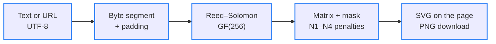

<div align="center">

# 🛡️ Fatos.online

> 🌐 Leia em [Português](./README.md)

[](#-how-it-works)

[](#️-technologies-used)

`HTML · CSS · Vanilla JavaScript · 0 dependencies · license not specified`

</div>

Landing page for **Fatos.online — Checagem & Verdade Digital** (Fact-Checking & Digital Truth), an initiative that fights misinformation with transparent fact-checking, academic references and media literacy. Built with plain HTML, CSS and JavaScript, with no frameworks and no build step: it opens straight in the browser and deploys to any static host. The page content is in Brazilian Portuguese.

---

## 📑 Table of Contents

- [🗂️ Project Structure](#️-project-structure)
- [🗂️ Project Structure - tree](#️-project-structure---tree)
- [🖼️ Preview](#️-preview)
- [🧭 Page map](#-page-map)
- [🔄 How it works](#-how-it-works)
- [🔎 Checar Fato tool](#-checar-fato-tool)
- [📚 References](#-references)
- [⚙️ Technologies used](#️-technologies-used)
- [🚀 How to run](#-how-to-run)
- [✨ Features](#-features)
- [🤝 Contributing](#-contributing)
- [📄 License](#-license)

---

## 🗂️ Project Structure

| Path | Description |
|---|---|
| `index.html` | Single page: header, hero with the Monitoring Center, the Checar Fato tool, the 6 content sections and footer. Holds the authorship metadata (`author`, Dublin Core, Open Graph and JSON-LD) and the icon sprite |
| `css/styles.css` | Dark and light theme tokens, frosted glass (glassmorphism), fluid typography with `clamp()` and breakpoints from 1280 px down to 360 px |
| `js/main.js` | Interactions: theme, mobile menu, active-section highlight, panel with animated counters and live updates, Checar Fato signal analysis, reference copying and the QR Code UI |
| `js/qrcode.js` | In-house QR Code generator (ISO/IEC 18004): UTF-8 byte mode, L/M/Q/H error correction, versions 1–40, Reed–Solomon and automatic mask selection; exports SVG and PNG |
| `assets/fonts/` | Merriweather 700 and Plus Jakarta Sans (variable) as WOFF2, self-hosted in the project |
| `assets/licenses/` | Licenses for the fonts (SIL OFL 1.1) and the Lucide icons (ISC) |
| `assets/favicon.svg` | Shield icon with a verification badge, same as the brand mark |
| `docs/preview-desktop.jpg` | Real screenshot of the page at 1440×900, also used as the Open Graph image |
| `docs/preview-mobile.jpg` | Real screenshot of the page at 390×844 |
| `humans.txt` | Authorship credits |
| `README.md` | This documentation in Portuguese |

---

## 🗂️ Project Structure - tree

```
🗂️
├── 📁 assets
│  ├── 📁 fonts
│  │  ├── 📄 merriweather-latin-700-normal.woff2
│  │  └── 📄 plus-jakarta-sans-latin-wght-normal.woff2
│  ├── 📁 licenses
│  │  ├── 🗒️ LICENSE-Lucide.txt
│  │  ├── 🗒️ LICENSE-Merriweather.txt
│  │  └── 🗒️ LICENSE-PlusJakartaSans.txt
│  └── 🖼️ favicon.svg
├── 📁 css
│  └── 🎨 styles.css
├── 📁 docs
│  ├── 🖼️ preview-desktop.jpg
│  └── 🖼️ preview-mobile.jpg
├── 📁 js
│  ├── ⚙️ main.js
│  └── ⚙️ qrcode.js
├── 📄 humans.txt
├── 🌐 index.html
├── 🇺🇸 README.en.md
└── 🇧🇷 README.md
```

---

## 🖼️ Preview

<div align="center">
  
  
</div>

<sub>Real screenshots of the page in the dark theme (1440×900 and 390×844).</sub>

---

## 🧭 Page map

| Section | Anchor | What it has |
|---|---|---|
| Início (Home) | `#inicio` | Badge, headline, calls to action and the Monitoring Center (a demo panel with simulated numbers, labeled as such) |
| Checar Fato (Fact check) | `#checar` | Local analysis of 8 warning signs and ready-made searches in fact-checking databases |
| 01 · The Disinformation Ecosystem and the Role of the Repository | `#sobre` | Information disorder, engagement algorithms, the role of AI and the pillars Methodological Transparency, Reproducibility and Knowledge Centralization |
| 02 · The Cross-Cutting Impact of Fake News on Society | `#impacto` | Democratic erosion and polarization; public health and science (OECD Truth Quest and the Ciência UFPR study); individual harm and collective violence |
| 03 · Complementary Coping Strategies | `#metodologia` | Technology and metrics (NLP, data scraping), IFCN-standard fact-checking with a 5-step workflow and a verdict scale, media and digital literacy |
| 04 · Practical Fact-Checking Cases | `#verificacoes` | Electric car batteries (False) and insomnia, brain waves and Alzheimer's (Misleading), with sources |
| 05 · Academic References | `#referencias` | 11 references in ABNT format, copied one by one or all at once |
| 06 · Connectivity & Quick Access | `#acesso` | QR Code generated in the browser, with PNG download, link copying and sharing |

The top menu follows the visual reference: **Início**, **Checar Fato**, **Verificações Recentes** and **Metodologia & Sobre** (which covers sections 01 to 03).

---

## 🔄 How it works



<sub>Blue border = step implemented in `js/qrcode.js`</sub>

The generator picks the smallest QR Code version that fits the content, raises the error-correction level while there is still room in that same version, and tries all 8 masks defined by the standard, keeping the one with the lowest penalty. Everything runs in the browser: the link is never sent to an external service.

```text
Input:             https://briandevbr.github.io/fatos.online/   (42 bytes)
External API:        sends the link to third parties and fails offline   ❌
FatosQR.encode():  version 3 · correction M · mask 1 · 29×29 modules                                  ✅
```

When the page is opened locally (`file://` or `localhost`), the QR Code points to the public address `https://briandevbr.github.io/fatos.online/`, since a phone cannot reach the local machine.

---

## 🔎 Checar Fato tool

The tool does not decide whether something is true: it flags language patterns common in hoaxes and builds searches on [Google Fact Check Explorer](https://toolbox.google.com/factcheck/explorer), Brazilian fact-checking agencies and [Google News](https://news.google.com/). The analysis is local — nothing leaves the browser.

| Warning sign (as shown on the page) | Weight |
|---|---|
| Pede urgência ou compartilhamento (asks for urgency or sharing) | 2 |
| Linguagem alarmista ou sensacionalista (alarmist or sensational language) | 2 |
| Texto em caixa alta (all-caps text) | 1 |
| Pontuação exagerada (excessive punctuation) | 1 |
| Autoridade vaga ou anônima (vague or anonymous authority) | 2 |
| Promessa absoluta ou milagrosa (absolute or miracle promise) | 2 |
| Narrativa conspiratória (conspiracy narrative) | 2 |
| Nenhuma fonte verificável (no verifiable source) | 1 |

Attention level by the sum of weights: **0** Low · **1–3** Moderate · **4–6** High · **7 or more** Very high. With the text from the **Usar exemplo** (Use example) button (*“URGENTE!!! Médicos confirmam que beber água morna com limão em jejum CURA A COVID EM 3 DIAS...”*), the result is **Very high**, with all 8 signs triggered. Links pasted into the field get guidance about the domain instead of a score.

---

## 📚 References

The full list in ABNT format (NBR 6023), with a copy button, is in section 05 of the page.

| Reference | Where it appears |
|---|---|
| [Allcott & Gentzkow (2017)](https://doi.org/10.1257/jep.31.2.211) — *Social media and fake news in the 2016 election* | 01 · Ecosystem |
| [Barboza & Servidoni (2021)](https://revista.fatectq.edu.br/interfacetecnologica/article/view/1168) — *O impacto das fake news na sociedade* | 02 · Public health and science |
| [Ciência UFPR (2025)](https://ciencia.ufpr.br/portal/divulgacao-de-fake-news-pode-ter-motivacoes-emocionais-e-estrategicas-diz-estudo/) — *Fake news afirmam crenças e criam senso identitário, diz estudo* | 02 · Public health and science |
| [Costa & Cais (2025)](https://doi.org/10.35295/sz.iisl/2247) — *A espiral da violência: o papel da disseminação das fake news* | 02 · Harm and violence |
| [Gomes & Dourado (2019)](https://doi.org/10.5007/1984-6924.2019v16n2p33) — *Fake news, um fenômeno de comunicação política entre jornalismo, política e democracia* | 02 · Democratic erosion |
| [Lesher, Pawelec & Fogarassy (2024)](https://doi.org/10.1787/92a94c0f-en) — *The OECD Truth Quest Survey: methodology and findings* | 02 · Public health and science |
| [Nyhan & Reifler (2010)](https://doi.org/10.1007/s11109-010-9112-2) — *When corrections fail* | 02 · Harm and violence |
| [Pennycook & Rand (2019)](https://doi.org/10.1016/j.cognition.2018.06.011) — *Lazy, not biased* | 03 · Literacy |
| [Rádio USP (2024)](https://jornal.usp.br/radio-usp/relatorio-da-ocde-mostra-que-brasileiros-sao-os-piores-em-identificar-noticias-falsas/) — *Relatório da OCDE mostra que brasileiros são os piores em identificar notícias falsas* | 02 · Public health and science |
| [Sanchez (2025)](https://acervodigital.ufpr.br/handle/1884/97164) — *O bem versus o mal* (PhD thesis, UFPR) | 02 · Public health and science |
| [Wardle & Derakhshan (2017)](https://rm.coe.int/information-disorder-toward-an-interdisciplinary-framework-for-researc/168076277c) — *Information disorder* | 01 · Ecosystem |

---

## ⚙️ Technologies used

- [HTML5](https://html.spec.whatwg.org/) — semantic structure (landmarks, `article`, `details`, `fieldset`), authorship metadata and [JSON-LD](https://schema.org/WebSite) structured data
- [CSS3](https://www.w3.org/Style/CSS/) — custom properties for the dark and light themes, Grid and Flexbox, `clamp()` for fluid typography and `backdrop-filter` for the frosted glass, with no preprocessor
- JavaScript (ES2020) — no frameworks and no build; classic `defer` scripts, so the page works even when opened straight from disk
- In-house QR Code generator — an implementation of the ISO/IEC 18004 standard in `js/qrcode.js`, with no third-party libraries
- [Merriweather](https://fonts.google.com/specimen/Merriweather) and [Plus Jakarta Sans](https://fonts.google.com/specimen/Plus+Jakarta+Sans) — headings and body text, self-hosted in `assets/fonts`
- [Lucide](https://lucide.dev/) — icons embedded in the page as an SVG sprite
- [GitHub Pages](https://pages.github.com/) (planned) — hosting for the public address used by the QR Code, the `canonical` link and Open Graph

---

## 🚀 How to run

Prerequisite: a current web browser. To serve the page locally, [Python 3](https://www.python.org/downloads/) or any static file server.

```bash
git clone https://github.com/briandevbr/fatos.online.git
cd fatos.online
python3 -m http.server 8080
```

The terminal prints `Serving HTTP on 0.0.0.0 port 8080 (http://0.0.0.0:8080/) ...` and the page opens at `http://localhost:8080`. You can also open `index.html` directly in the browser, with no server.

### Deploy to GitHub Pages

In **Settings → Pages**, choose **Deploy from a branch**, the `main` branch and the `/ (root)` folder. The site then answers at `https://briandevbr.github.io/fatos.online/`, the same address already used by the QR Code and the meta tags.

---

## ✨ Features

- Sticky header with smooth scrolling, active-section highlight and a mobile menu
- Hero with badge, serif headline with a wavy underline and calls to action
- Monitoring Center with animated counters, live updates, an activity chart and a pause button (simulated numbers, labeled on the panel itself)
- Checar Fato tool with 8 warning signs analyzed in the browser and ready-made searches in fact-checking databases
- Six content sections with citations linked to the references
- Two practical cases with a verdict, “what holds up / what doesn't” and the sources consulted
- 11 references in ABNT format, copied one by one or all at once
- QR Code generated in the browser, with preset destinations, custom address, PNG download, copying and sharing
- Dark (default) and light themes, remembered between visits
- Fluid layout from 320 px to wide screens, keyboard navigation and support for `prefers-reduced-motion`
- Authorship credits in the meta tags, in `humans.txt` and in the file headers

---

## 🤝 Contributing

Personal project — no formal contribution process at the moment. Found a mistake in a fact-check or a reference? Open an [issue](https://github.com/briandevbr/fatos.online/issues): corrections are welcome and consistent with the corrections policy the project itself stands for.

---

## 📄 License

License not specified. The fonts ([SIL OFL 1.1](./assets/licenses/LICENSE-Merriweather.txt)) and icons ([ISC](./assets/licenses/LICENSE-Lucide.txt)) follow their authors' licenses, included in `assets/licenses/`.

---

<div align="center">
  <sub>Made by <a href="https://github.com/briandevbr">David Brian</a> · landing page for the Fatos.online fact-checking initiative</sub>
</div>
