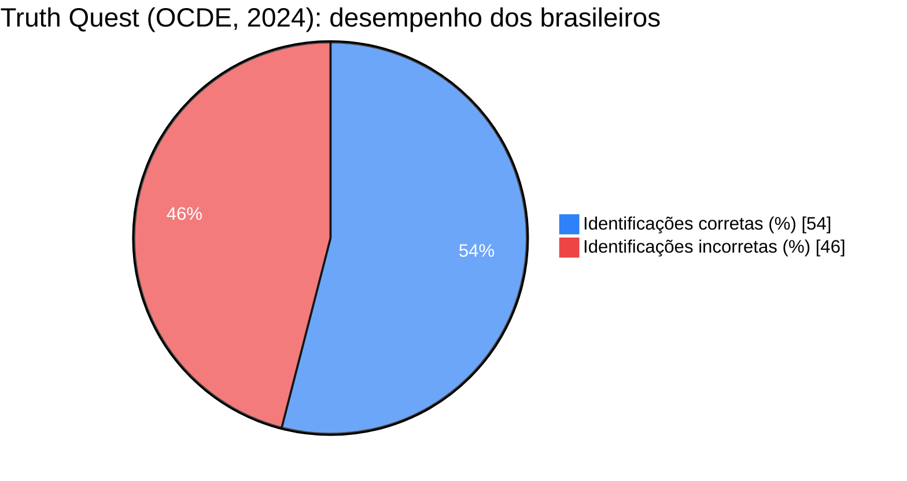
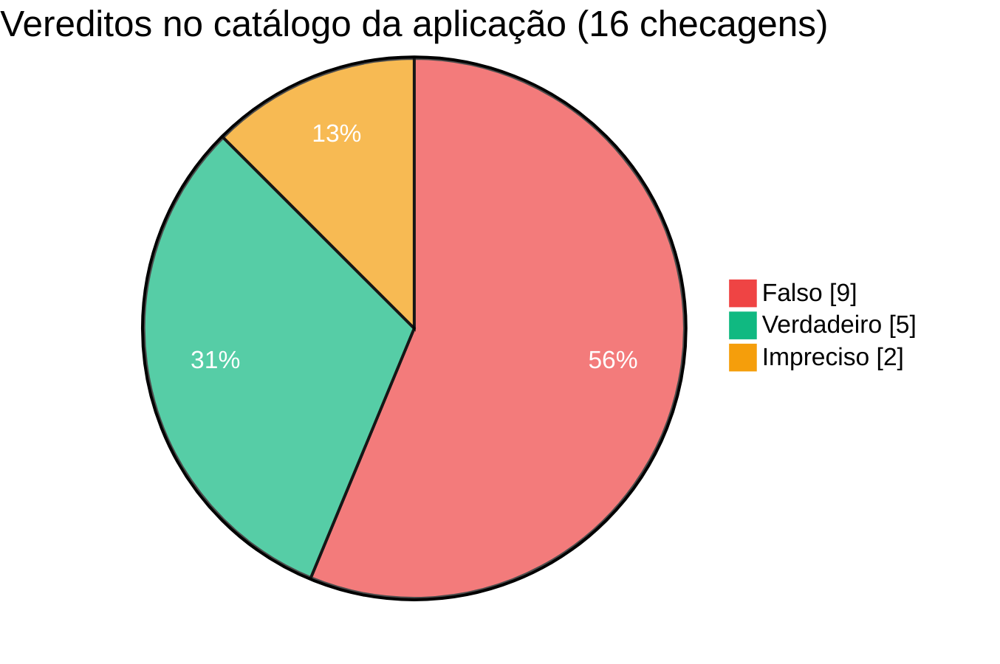
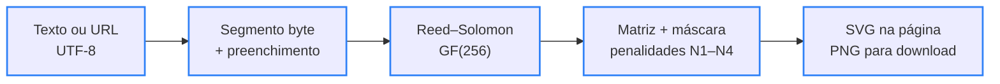

<div align="center">

# 🛡️ Fatos.online

> 🌐 Read this in [English](./README.en.md)

[](#-como-funciona)

[](#️-tecnologias-usadas)

[](./LICENSE)
[](#-equipe)
[](#-mapa-da-página)
[](#-aplicação-de-checagem)

`Landing: HTML · CSS · JS puro · App: React · Express · Gemini · Apache-2.0`

</div>

Projeto acadêmico **Fatos.online — Checagem & Verdade Digital**, desenvolvido em grupo para combater a desinformação com checagem de fatos transparente, referências acadêmicas e letramento midiático. O repositório reúne a **landing page** estática (raiz, sem frameworks nem build) e a **aplicação de checagem** full-stack com IA (pasta `app/`).

---

## 📑 Sumário

- [🗂️ Estrutura do Projeto](#️-estrutura-do-projeto)
- [🗂️ Estrutura do Projeto - tree](#️-estrutura-do-projeto---tree)
- [👥 Equipe](#-equipe)
- [🖼️ Prévia](#️-prévia)
- [🧭 Mapa da página](#-mapa-da-página)
- [🧩 Aplicação de checagem](#-aplicação-de-checagem)
- [📡 Endpoints da API](#-endpoints-da-api)
- [📦 O dataset](#-o-dataset)
- [📊 Gráficos](#-gráficos)
- [🔄 Como funciona](#-como-funciona)
- [🔎 Checar Fato](#-checar-fato)
- [📚 Referências](#-referências)
- [⚙️ Tecnologias usadas](#️-tecnologias-usadas)
- [🚀 Como rodar](#-como-rodar)
- [✨ Funcionalidades](#-funcionalidades)
- [🤝 Contribuindo](#-contribuindo)
- [📄 Licença](#-licença)

---

## 🗂️ Estrutura do Projeto

| Caminho | Descrição |
|---|---|
| `index.html` | Landing page: cabeçalho, hero com a Central de Monitoramento, ferramenta Checar Fato, as 6 seções de conteúdo e rodapé com a equipe. Concentra os metadados (`author`, Dublin Core, Open Graph e JSON-LD com os 10 integrantes) e o sprite de ícones |
| `css/styles.css` | Tokens dos temas escuro e claro, vidro fosco (glassmorphism), tipografia fluida com `clamp()` e pontos de quebra de 1280 px a 360 px |
| `js/main.js` | Interações da landing: tema, menu móvel, destaque da seção ativa, painel com contagem animada, análise de sinais do Checar Fato, cópia de referências e interface do QR Code |
| `js/qrcode.js` | Gerador de QR Code próprio (ISO/IEC 18004): modo byte UTF-8, correção L/M/Q/H, versões 1–40, Reed–Solomon e escolha automática de máscara; exporta SVG e PNG |
| `app/` | Aplicação de checagem full-stack exportada do Google AI Studio: front-end React + Vite + Tailwind e servidor Express com a API do Gemini |
| `app/server/` | `gemini.ts` (checagem com IA, busca em tempo real e avaliador de evidências de reserva), `routes.ts` (6 rotas da API) e `storage.ts` (persistência em JSON) |
| `app/src/` | Interface em React: `App.tsx`, 9 componentes (`Hero`, `FactChecker`, `MediaUploader`, `RadarSection`, `RecentChecks`, `Newsletter`, `AboutMethodology`, `Header`, `Footer`) e tipos compartilhados |
| `app/.data/fact_checks.json` | Catálogo de checagens servido pela API (16 registros) |
| `app/db/schema.sql` | Schema relacional equivalente (PostgreSQL/SQLite) para newsletter e checagens |
| `app/.env.example` | Modelo das variáveis de ambiente (`GEMINI_API_KEY`, `APP_URL`) |
| `app/.aistudio/` | Plano de implementação gerado no Google AI Studio |
| `assets/fonts/` | Merriweather 700 e Plus Jakarta Sans (variável) em WOFF2, hospedadas no próprio projeto |
| `assets/licenses/` | Licenças das fontes (SIL OFL 1.1) e dos ícones Lucide (ISC) |
| `assets/favicon.svg` | Ícone do escudo com selo de verificação, o mesmo da marca |
| `docs/` | Capturas reais da landing (1440×900 e 390×844) e da aplicação (1440×900) |
| `humans.txt` | Créditos da equipe |
| `_config.yml` | Configuração do GitHub Pages: publica só a landing e deixa `app/` de fora |
| `LICENSE` | Texto integral da licença Apache-2.0 |
| `README.en.md` | Esta documentação em inglês |

---

## 🗂️ Estrutura do Projeto - tree

```
🗂️
├── 📁 app
│  ├── 📁 .aistudio
│  │  └── … (2 arquivos)
│  ├── 📁 .data
│  │  └── 📈 fact_checks.json
│  ├── 📁 db
│  │  └── 📈 schema.sql
│  ├── 📁 server
│  │  ├── ⚙️ gemini.ts
│  │  ├── ⚙️ routes.ts
│  │  └── ⚙️ storage.ts
│  ├── 📁 src
│  │  ├── 📁 components
│  │  │  └── … (9 arquivos)
│  │  ├── 📁 types
│  │  │  └── ⚙️ index.ts
│  │  ├── ⚙️ App.tsx
│  │  ├── 🎨 index.css
│  │  └── ⚙️ main.tsx
│  ├── 🔧 .env.example
│  ├── 🔧 .gitignore
│  ├── 🌐 index.html
│  ├── 🔧 metadata.json
│  ├── 📦 package-lock.json
│  ├── 📦 package.json
│  ├── 📄 README.md
│  ├── ⚙️ server.ts
│  ├── 🔧 tsconfig.json
│  └── 🔧 vite.config.ts
├── 📁 assets
│  ├── 📁 fonts
│  │  ├── 📄 merriweather-latin-700-normal.woff2
│  │  └── 📄 plus-jakarta-sans-latin-wght-normal.woff2
│  ├── 📁 licenses
│  │  ├── 🗒️ LICENSE-Lucide.txt
│  │  ├── 🗒️ LICENSE-Merriweather.txt
│  │  └── 🗒️ LICENSE-PlusJakartaSans.txt
│  └── 🖼️ favicon.svg
├── 📁 css
│  └── 🎨 styles.css
├── 📁 docs
│  ├── 🖼️ preview-app.jpg
│  ├── 🖼️ preview-desktop.jpg
│  └── 🖼️ preview-mobile.jpg
├── 📁 js
│  ├── ⚙️ main.js
│  └── ⚙️ qrcode.js
├── 🔧 .gitignore
├── 🔧 _config.yml
├── 📄 humans.txt
├── 🌐 index.html
├── 🗒️ LICENSE
├── 🇺🇸 README.en.md
└── 🇧🇷 README.md
```

---

## 👥 Equipe

Projeto acadêmico desenvolvido em grupo. Integrantes em ordem alfabética de usuário do GitHub:

<table>
  <tr>
    <td align="center"><a href="https://github.com/Andersmatias9278-hub"><br><sub><b>Andersmatias9278-hub</b></sub></a></td>
    <td align="center"><a href="https://github.com/briandevbr"><br><sub><b>David Brian</b><br>@briandevbr</sub></a></td>
    <td align="center"><a href="https://github.com/Davipcarvalh0"><br><sub><b>Davi P. Carvalho</b><br>@Davipcarvalh0</sub></a></td>
    <td align="center"><a href="https://github.com/GabrielleSophia"><br><sub><b>GabrielleSophia</b></sub></a></td>
    <td align="center"><a href="https://github.com/JoaoCGjr"><br><sub><b>JoaoCGjr</b></sub></a></td>
  </tr>
  <tr>
    <td align="center"><a href="https://github.com/larpras"><br><sub><b>larpras</b></sub></a></td>
    <td align="center"><a href="https://github.com/lucianohvn"><br><sub><b>Luciano</b><br>@lucianohvn</sub></a></td>
    <td align="center"><a href="https://github.com/luferc1"><br><sub><b>lucasmacedo</b><br>@luferc1</sub></a></td>
    <td align="center"><a href="https://github.com/matheuseduardo-cpu"><br><sub><b>matheuseduardo-cpu</b></sub></a></td>
    <td align="center"><a href="https://github.com/Victoriabueno22"><br><sub><b>Victoriabueno22</b></sub></a></td>
  </tr>
</table>

<sub>A lista lateral “Contributors” do GitHub mostra só quem já fez commit; a equipe completa é esta.</sub>

---

## 🖼️ Prévia

<div align="center">
  
  
</div>

<div align="center">
  
</div>

<sub>Capturas reais: landing no tema escuro (1440×900 e 390×844) e aplicação rodando localmente no tema claro (1440×900).</sub>

---

## 🧭 Mapa da página

| Seção | Âncora | O que tem |
|---|---|---|
| Início | `#inicio` | Selo, título, chamadas para ação e a Central de Monitoramento (painel demonstrativo, com números simulados e sinalizados como tal) |
| Checar Fato | `#checar` | Análise local de 8 sinais de alerta, buscas prontas em bases de checagem e indicação da aplicação completa em `app/` |
| 01 · O Ecossistema da Desinformação e o Papel do Repositório | `#sobre` | Desordem informacional, algoritmos de engajamento, papel da IA e os pilares Transparência Metodológica, Reprodutibilidade e Centralização de Conhecimento |
| 02 · O Impacto Transversal das Fake News na Sociedade | `#impacto` | Erosão democrática e polarização; saúde pública e ciência (Truth Quest da OCDE e estudo da Ciência UFPR); danos individuais e violência coletiva |
| 03 · Estratégias Complementares de Enfrentamento | `#metodologia` | Tecnologia e métricas (PLN, raspagem de dados), checagem nos padrões da IFCN com fluxo de 5 etapas e escala de vereditos, letramento mídia-digital |
| 04 · Casos Práticos de Checagem e Verificação Recentes | `#verificacoes` | Baterias de carros elétricos (Falso) e insônia, ondas cerebrais e Alzheimer (Enganoso), com fontes |
| 05 · Referências Bibliográficas Acadêmicas | `#referencias` | 11 referências em ABNT, com cópia individual ou de todas |
| 06 · Conectividade & Acesso Rápido | `#acesso` | QR Code gerado no navegador, com download em PNG, cópia e compartilhamento do link |
| Equipe do projeto | `#equipe` | Os 10 integrantes, com avatar e link para o perfil no GitHub |

O menu do topo segue a referência visual: **Início**, **Checar Fato**, **Verificações Recentes** e **Metodologia & Sobre** (que cobre as seções 01 a 03).

---

## 🧩 Aplicação de checagem

A pasta `app/` traz a aplicação completa exportada do [Google AI Studio](https://aistudio.google.com/): o usuário envia um texto, link, imagem ou vídeo; o servidor busca notícias recentes, consulta o Gemini e devolve um veredito (`verdadeiro`, `falso`, `impreciso` ou `nao_verificavel`) com confiança, explicação e fontes. Ela também tem catálogo de checagens com filtros, radar de tendências e newsletter com consentimento LGPD.

Ajustes feitos na integração para a aplicação instalar, compilar e responder corretamente:

- `package.json`: `esbuild` atualizado de `^0.25.0` para `^0.28.0` — a versão original conflitava com o Vite 8 e o `npm install` falhava; também ganhou nome (`fatos-online-app`) e o campo `license`.
- `server/gemini.ts`: o avaliador de evidências usado quando o Gemini não responde recebia os argumentos na ordem errada (erro apontado pelo `npm run lint`) e quebrava; agora devolve um veredito baseado nas matérias encontradas.
- `src/components/Footer.tsx`: “Todos os direitos reservados” virou o crédito à equipe e à licença Apache-2.0.
- `.gitignore`: a base de assinantes da newsletter (`.data/subscribers.json`) não é versionada, por ser dado pessoal; a aplicação recria o arquivo ao iniciar.

---

## 📡 Endpoints da API

| Método | Rota | O que faz |
|---|---|---|
| `GET` | `/api/health` | Verifica se o servidor está no ar |
| `POST` | `/api/fact-check` | Checa um conteúdo (`text`, `link` ou mídia em base64) e salva o resultado no catálogo |
| `POST` | `/api/newsletter` | Inscreve na newsletter (exige `email` e consentimento LGPD) |
| `GET` | `/api/recent-checks` | Lista checagens, com filtros `category`, `search` e `limit` |
| `GET` | `/api/stats` | Totais exibidos no painel da aplicação |
| `GET` | `/api/radar-trends` | Tendências em circulação, via Gemini com busca no Google |

Resposta real de `GET /api/health` com o servidor rodando localmente:

```json
{"status":"online","service":"Fatos.online Fact-Checking API","timestamp":"2026-10-22T17:05:50.201Z"}
```

---

## 📦 O dataset

| Item | Detalhe |
|---|---|
| Arquivo | `app/.data/fact_checks.json` — lido e atualizado por `server/storage.ts` |
| Conteúdo | Checagens com alegação, categoria, veredito, confiança (0–100), explicação, pontos-chave e fontes |
| Cobertura | 16 registros: 6 exemplos iniciais e 10 checagens geradas pela IA em testes |
| Vereditos | 9 falsos, 5 verdadeiros e 2 imprecisos |
| Categorias | Política (8), Saúde & Ciência (5), Tecnologia & IA (2), Redes Sociais & Golpes (1) |
| Período | 19 a 22 de outubro de 2026 |
| Formato | JSON (UTF-8), um objeto por checagem |
| Peculiaridades | Duas checagens geradas em teste foram removidas na integração por trazerem veredito errado sobre a falsa “taxa de 15% no Pix” (uma a classificava como verdadeira). As três checagens sobre a “taxa das blusinhas” citam matérias sobre o fim da taxa como confirmação e ainda precisam de revisão humana. Os totais de `/api/stats` (ex.: 14.836 verificações) somam uma base fixa de 14.820 definida no código e são demonstrativos |

---

## 📊 Gráficos



<sub>Fonte: [The OECD Truth Quest Survey](https://doi.org/10.1787/92a94c0f-en) (Lesher; Pawelec; Fogarassy, 2024). O Brasil ficou em último lugar entre 21 países; a média geral foi de 60%.</sub>



<sub>Fonte: contagem de `app/.data/fact_checks.json` — veja as observações em [O dataset](#-o-dataset).</sub>

---

## 🔄 Como funciona



<sub>Borda azul = etapa implementada em `js/qrcode.js`</sub>

O gerador da landing escolhe a menor versão de QR Code em que o conteúdo cabe, sobe o nível de correção de erros enquanto ainda houver espaço na mesma versão e testa as 8 máscaras da norma, ficando com a de menor penalidade. Tudo roda no navegador: o link nunca é enviado a um serviço externo.

```text
Entrada:           https://briandevbr.github.io/fatos.online/   (42 bytes)
API externa:         envia o link a terceiros e falha offline   ❌
FatosQR.encode():  versão 3 · correção M · máscara 1 · 29×29 módulos                             ✅
```

Quando a página é aberta localmente (`file://` ou `localhost`), o QR Code usa o endereço público `https://briandevbr.github.io/fatos.online/`, já que o celular não alcança a máquina local.

---

## 🔎 Checar Fato

A ferramenta da landing não decide se algo é verdadeiro: ela aponta padrões linguísticos comuns em boatos e monta buscas no [Google Fact Check Explorer](https://toolbox.google.com/factcheck/explorer), em agências brasileiras de checagem e no [Google Notícias](https://news.google.com/). A análise é local — nada sai do navegador. Para checagem com IA, a página indica a aplicação em `app/`.

| Sinal de alerta | Peso |
|---|---|
| Pede urgência ou compartilhamento | 2 |
| Linguagem alarmista ou sensacionalista | 2 |
| Texto em caixa alta | 1 |
| Pontuação exagerada | 1 |
| Autoridade vaga ou anônima | 2 |
| Promessa absoluta ou milagrosa | 2 |
| Narrativa conspiratória | 2 |
| Nenhuma fonte verificável | 1 |

Nível de atenção pela soma dos pesos: **0** Baixo · **1–3** Moderado · **4–6** Alto · **7 ou mais** Muito alto. Com o texto do botão **Usar exemplo** (*“URGENTE!!! Médicos confirmam que beber água morna com limão em jejum CURA A COVID EM 3 DIAS...”*), o resultado é **Muito alto**, com os 8 sinais acionados. Links colados no campo recebem orientações sobre o domínio, em vez de pontuação.

---

## 📚 Referências

A lista completa em ABNT (NBR 6023), com botão de copiar, está na seção 05 da landing.

| Referência | Onde aparece |
|---|---|
| [Allcott & Gentzkow (2017)](https://doi.org/10.1257/jep.31.2.211) — *Social media and fake news in the 2016 election* | 01 · Ecossistema |
| [Barboza & Servidoni (2021)](https://revista.fatectq.edu.br/interfacetecnologica/article/view/1168) — *O impacto das fake news na sociedade* | 02 · Saúde pública e ciência |
| [Ciência UFPR (2025)](https://ciencia.ufpr.br/portal/divulgacao-de-fake-news-pode-ter-motivacoes-emocionais-e-estrategicas-diz-estudo/) — *Fake news afirmam crenças e criam senso identitário, diz estudo* | 02 · Saúde pública e ciência |
| [Costa & Cais (2025)](https://doi.org/10.35295/sz.iisl/2247) — *A espiral da violência: o papel da disseminação das fake news* | 02 · Danos e violência |
| [Gomes & Dourado (2019)](https://doi.org/10.5007/1984-6924.2019v16n2p33) — *Fake news, um fenômeno de comunicação política entre jornalismo, política e democracia* | 02 · Erosão democrática |
| [Lesher, Pawelec & Fogarassy (2024)](https://doi.org/10.1787/92a94c0f-en) — *The OECD Truth Quest Survey: methodology and findings* | 02 · Saúde pública e ciência |
| [Nyhan & Reifler (2010)](https://doi.org/10.1007/s11109-010-9112-2) — *When corrections fail* | 02 · Danos e violência |
| [Pennycook & Rand (2019)](https://doi.org/10.1016/j.cognition.2018.06.011) — *Lazy, not biased* | 03 · Letramento |
| [Rádio USP (2024)](https://jornal.usp.br/radio-usp/relatorio-da-ocde-mostra-que-brasileiros-sao-os-piores-em-identificar-noticias-falsas/) — *Relatório da OCDE mostra que brasileiros são os piores em identificar notícias falsas* | 02 · Saúde pública e ciência |
| [Sanchez (2025)](https://acervodigital.ufpr.br/handle/1884/97164) — *O bem versus o mal* (tese, UFPR) | 02 · Saúde pública e ciência |
| [Wardle & Derakhshan (2017)](https://rm.coe.int/information-disorder-toward-an-interdisciplinary-framework-for-researc/168076277c) — *Information disorder* | 01 · Ecossistema |

---

## ⚙️ Tecnologias usadas

**Landing page (raiz)**

- [HTML5](https://html.spec.whatwg.org/) — estrutura semântica (landmarks, `article`, `details`, `fieldset`), metadados de autoria e dados estruturados [JSON-LD](https://schema.org/WebSite)
- [CSS3](https://www.w3.org/Style/CSS/) — variáveis para os temas escuro e claro, Grid e Flexbox, `clamp()` para tipografia fluida e `backdrop-filter` para o vidro fosco, sem pré-processador
- JavaScript (ES2020) — sem frameworks nem build; scripts clássicos com `defer`, por isso a página funciona até aberta direto do disco
- Gerador de QR Code próprio — implementação da norma ISO/IEC 18004 em `js/qrcode.js`, sem bibliotecas de terceiros
- [Merriweather](https://fonts.google.com/specimen/Merriweather) e [Plus Jakarta Sans](https://fonts.google.com/specimen/Plus+Jakarta+Sans) — títulos e texto, hospedadas em `assets/fonts`
- [Lucide](https://lucide.dev/) — ícones embutidos na página como sprite SVG

**Aplicação (`app/`)** — versões do `package-lock.json`

- [TypeScript](https://www.typescriptlang.org/) 7.0.2 — tipagem do front-end e do servidor (`npm run lint`)
- [React](https://react.dev/) 19.3.1 — interface em componentes
- [Vite](https://vite.dev/) 8.3.5 — servidor de desenvolvimento e build de produção
- [Tailwind CSS](https://tailwindcss.com/) 4.3.3 — estilos utilitários, com temas claro e escuro
- [Express](https://expressjs.com/) 4.22.3 e [Node.js](https://nodejs.org/) — servidor da API e dos arquivos compilados
- [Google Gen AI SDK](https://www.npmjs.com/package/@google/genai) 2.30.0 — chamadas ao Gemini com busca no Google
- [tsx](https://tsx.is/) 4.23.15 — executa o `server.ts` direto em TypeScript

**Publicação**

- [GitHub Pages](https://pages.github.com/) (planejado) — hospedagem da landing no endereço público usado pelo QR Code, pelo `canonical` e pelo Open Graph

---

## 🚀 Como rodar

### Landing page

Pré-requisito: um navegador atual. Para servir a página localmente, [Python 3](https://www.python.org/downloads/) ou qualquer servidor estático.

```bash
git clone https://github.com/briandevbr/fatos.online.git
cd fatos.online
python3 -m http.server 8080
```

O terminal mostra `Serving HTTP on 0.0.0.0 port 8080 (http://0.0.0.0:8080/) ...` e a página abre em `http://localhost:8080`. Também dá para abrir o `index.html` direto no navegador, sem servidor.

### Aplicação

Pré-requisitos: [Node.js](https://nodejs.org/) 18 ou superior e uma chave da API do Gemini, gerada no [Google AI Studio](https://aistudio.google.com/).

```bash
cd app
cp .env.example .env      # preencha GEMINI_API_KEY
npm install
npm run dev
```

O terminal mostra `[Fatos.online] Servidor ativo em http://0.0.0.0:3000 (Desenvolvimento)` e a aplicação abre em `http://localhost:3000`. Sem a chave, a interface e o catálogo funcionam, e as novas checagens usam só o avaliador de evidências da busca. Para produção:

```bash
npm run build
NODE_ENV=production npm start
```

### Publicar no GitHub Pages

Em **Settings → Pages**, escolha **Deploy from a branch**, a branch `main` e a pasta `/ (root)`. O site passa a responder em `https://briandevbr.github.io/fatos.online/`; o `_config.yml` deixa `app/` fora da publicação, já que a aplicação precisa de um servidor Node.js.

---

## ✨ Funcionalidades

**Landing page**

- Cabeçalho fixo com rolagem suave, destaque da seção ativa e menu para celular
- Hero com selo, título serifado com sublinhado ondulado e chamadas para ação
- Central de Monitoramento com contagem animada, atualização ao vivo, gráfico de atividade e botão de pausa (números simulados, sinalizados no próprio painel)
- Checar Fato com 8 sinais de alerta analisados no navegador e buscas prontas em bases de checagem
- Seis seções de conteúdo com citações ligadas às referências
- Dois casos práticos com veredito, “o que procede / o que não procede” e fontes consultadas
- 11 referências em ABNT com cópia individual ou de todas
- QR Code gerado no navegador, com destinos prontos, endereço personalizado, download em PNG, cópia e compartilhamento
- Rodapé com a equipe completa, avatares e links para os perfis
- Tema escuro (padrão) e claro, lembrado entre visitas
- Layout fluido de 320 px a telas largas, navegação por teclado e respeito a `prefers-reduced-motion`

**Aplicação**

- Checagem de texto, links de redes sociais, imagens e vídeos com o Gemini e busca de notícias recentes
- Veredito com nível de confiança, explicação, pontos-chave e fontes clicáveis
- Catálogo de verificações recentes com filtro por categoria e busca
- Radar de tendências em circulação
- Newsletter com consentimento LGPD e bloqueio de inscrições duplicadas
- Temas claro e escuro

---

## 🤝 Contribuindo

Projeto acadêmico em equipe — os integrantes têm acesso de escrita ao repositório.

1. Atualize a `main` e crie um branch: `git switch -c feat/descricao-curta`
2. Faça commits no padrão [Conventional Commits](https://www.conventionalcommits.org/pt-br/v1.0.0/), com escopo quando fizer sentido: `feat(app): ...`, `fix(landing): ...`, `docs: ...`
3. Envie o branch com `git push -u origin feat/descricao-curta` e abra um Pull Request para a `main`

Encontrou um erro em uma checagem ou referência? Abra uma [issue](https://github.com/briandevbr/fatos.online/issues): correções públicas fazem parte da metodologia do projeto.

---

## 📄 Licença

Distribuído sob a licença [Apache-2.0](./LICENSE). As fontes ([SIL OFL 1.1](./assets/licenses/LICENSE-Merriweather.txt)) e os ícones ([ISC](./assets/licenses/LICENSE-Lucide.txt)) seguem as licenças de seus autores, incluídas em `assets/licenses/`.

---

<div align="center">
  <sub>Feito pela <a href="#-equipe">equipe acadêmica Fatos.online</a> · checagem de fatos, ciência aberta e letramento midiático</sub>
</div>
