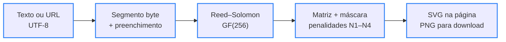

<div align="center">

# 🛡️ Fatos.online

> 🌐 Read this in [English](./README.en.md)

[](#-como-funciona)

[](#️-tecnologias-usadas)

`HTML · CSS · JavaScript puro · 0 dependências · licença não especificada`

</div>

Landing page da iniciativa **Fatos.online — Checagem & Verdade Digital**, que combate a desinformação com checagem de fatos transparente, referências acadêmicas e letramento midiático. Feita em HTML, CSS e JavaScript puros, sem frameworks nem etapa de build: abre direto no navegador e publica em qualquer hospedagem estática.

---

## 📑 Sumário

- [🗂️ Estrutura do Projeto](#️-estrutura-do-projeto)
- [🗂️ Estrutura do Projeto - tree](#️-estrutura-do-projeto---tree)
- [🖼️ Prévia](#️-prévia)
- [🧭 Mapa da página](#-mapa-da-página)
- [🔄 Como funciona](#-como-funciona)
- [🔎 Checar Fato](#-checar-fato)
- [📚 Referências](#-referências)
- [⚙️ Tecnologias usadas](#️-tecnologias-usadas)
- [🚀 Como rodar](#-como-rodar)
- [✨ Funcionalidades](#-funcionalidades)
- [🤝 Contribuindo](#-contribuindo)
- [📄 Licença](#-licença)

---

## 🗂️ Estrutura do Projeto

| Caminho | Descrição |
|---|---|
| `index.html` | Página única: cabeçalho, hero com a Central de Monitoramento, ferramenta Checar Fato, as 6 seções de conteúdo e rodapé. Concentra os metadados de autoria (`author`, Dublin Core, Open Graph e JSON-LD) e o sprite de ícones |
| `css/styles.css` | Tokens dos temas escuro e claro, vidro fosco (glassmorphism), tipografia fluida com `clamp()` e pontos de quebra de 1280 px a 360 px |
| `js/main.js` | Interações: tema, menu móvel, destaque da seção ativa, painel com contagem animada e atualização ao vivo, análise de sinais do Checar Fato, cópia de referências e interface do QR Code |
| `js/qrcode.js` | Gerador de QR Code próprio (ISO/IEC 18004): modo byte UTF-8, correção L/M/Q/H, versões 1–40, Reed–Solomon e escolha automática de máscara; exporta SVG e PNG |
| `assets/fonts/` | Merriweather 700 e Plus Jakarta Sans (variável) em WOFF2, hospedadas no próprio projeto |
| `assets/licenses/` | Licenças das fontes (SIL OFL 1.1) e dos ícones Lucide (ISC) |
| `assets/favicon.svg` | Ícone do escudo com selo de verificação, o mesmo da marca |
| `docs/preview-desktop.jpg` | Captura real da página em 1440×900, usada também como imagem do Open Graph |
| `docs/preview-mobile.jpg` | Captura real da página em 390×844 |
| `humans.txt` | Créditos de autoria |
| `README.en.md` | Esta documentação em inglês |

---

## 🗂️ Estrutura do Projeto - tree

```
🗂️
├── 📁 assets
│  ├── 📁 fonts
│  │  ├── 📄 merriweather-latin-700-normal.woff2
│  │  └── 📄 plus-jakarta-sans-latin-wght-normal.woff2
│  ├── 📁 licenses
│  │  ├── 🗒️ LICENSE-Lucide.txt
│  │  ├── 🗒️ LICENSE-Merriweather.txt
│  │  └── 🗒️ LICENSE-PlusJakartaSans.txt
│  └── 🖼️ favicon.svg
├── 📁 css
│  └── 🎨 styles.css
├── 📁 docs
│  ├── 🖼️ preview-desktop.jpg
│  └── 🖼️ preview-mobile.jpg
├── 📁 js
│  ├── ⚙️ main.js
│  └── ⚙️ qrcode.js
├── 📄 humans.txt
├── 🌐 index.html
├── 🇺🇸 README.en.md
└── 🇧🇷 README.md
```

---

## 🖼️ Prévia

<div align="center">
  
  
</div>

<sub>Capturas reais da página no tema escuro (1440×900 e 390×844).</sub>

---

## 🧭 Mapa da página

| Seção | Âncora | O que tem |
|---|---|---|
| Início | `#inicio` | Selo, título, chamadas para ação e a Central de Monitoramento (painel demonstrativo, com números simulados e sinalizados como tal) |
| Checar Fato | `#checar` | Análise local de 8 sinais de alerta e buscas prontas em bases de checagem |
| 01 · O Ecossistema da Desinformação e o Papel do Repositório | `#sobre` | Desordem informacional, algoritmos de engajamento, papel da IA e os pilares Transparência Metodológica, Reprodutibilidade e Centralização de Conhecimento |
| 02 · O Impacto Transversal das Fake News na Sociedade | `#impacto` | Erosão democrática e polarização; saúde pública e ciência (Truth Quest da OCDE e estudo da Ciência UFPR); danos individuais e violência coletiva |
| 03 · Estratégias Complementares de Enfrentamento | `#metodologia` | Tecnologia e métricas (PLN, raspagem de dados), checagem nos padrões da IFCN com fluxo de 5 etapas e escala de vereditos, letramento mídia-digital |
| 04 · Casos Práticos de Checagem e Verificação Recentes | `#verificacoes` | Baterias de carros elétricos (Falso) e insônia, ondas cerebrais e Alzheimer (Enganoso), com fontes |
| 05 · Referências Bibliográficas Acadêmicas | `#referencias` | 11 referências em ABNT, com cópia individual ou de todas |
| 06 · Conectividade & Acesso Rápido | `#acesso` | QR Code gerado no navegador, com download em PNG, cópia e compartilhamento do link |

O menu do topo segue a referência visual: **Início**, **Checar Fato**, **Verificações Recentes** e **Metodologia & Sobre** (que cobre as seções 01 a 03).

---

## 🔄 Como funciona



<sub>Borda azul = etapa implementada em `js/qrcode.js`</sub>

O gerador escolhe a menor versão de QR Code em que o conteúdo cabe, sobe o nível de correção de erros enquanto ainda houver espaço na mesma versão e testa as 8 máscaras da norma, ficando com a de menor penalidade. Tudo roda no navegador: o link nunca é enviado a um serviço externo.

```text
Entrada:           https://briandevbr.github.io/fatos.online/   (42 bytes)
API externa:         envia o link a terceiros e falha offline   ❌
FatosQR.encode():  versão 3 · correção M · máscara 1 · 29×29 módulos                             ✅
```

Quando a página é aberta localmente (`file://` ou `localhost`), o QR Code usa o endereço público `https://briandevbr.github.io/fatos.online/`, já que o celular não alcança a máquina local.

---

## 🔎 Checar Fato

A ferramenta não decide se algo é verdadeiro: ela aponta padrões linguísticos comuns em boatos e monta buscas no [Google Fact Check Explorer](https://toolbox.google.com/factcheck/explorer), em agências brasileiras de checagem e no [Google Notícias](https://news.google.com/). A análise é local — nada sai do navegador.

| Sinal de alerta | Peso |
|---|---|
| Pede urgência ou compartilhamento | 2 |
| Linguagem alarmista ou sensacionalista | 2 |
| Texto em caixa alta | 1 |
| Pontuação exagerada | 1 |
| Autoridade vaga ou anônima | 2 |
| Promessa absoluta ou milagrosa | 2 |
| Narrativa conspiratória | 2 |
| Nenhuma fonte verificável | 1 |

Nível de atenção pela soma dos pesos: **0** Baixo · **1–3** Moderado · **4–6** Alto · **7 ou mais** Muito alto. Com o texto do botão **Usar exemplo** (*“URGENTE!!! Médicos confirmam que beber água morna com limão em jejum CURA A COVID EM 3 DIAS...”*), o resultado é **Muito alto**, com os 8 sinais acionados. Links colados no campo recebem orientações sobre o domínio, em vez de pontuação.

---

## 📚 Referências

A lista completa em ABNT (NBR 6023), com botão de copiar, está na seção 05 da página.

| Referência | Onde aparece |
|---|---|
| [Allcott & Gentzkow (2017)](https://doi.org/10.1257/jep.31.2.211) — *Social media and fake news in the 2016 election* | 01 · Ecossistema |
| [Barboza & Servidoni (2021)](https://revista.fatectq.edu.br/interfacetecnologica/article/view/1168) — *O impacto das fake news na sociedade* | 02 · Saúde pública e ciência |
| [Ciência UFPR (2025)](https://ciencia.ufpr.br/portal/divulgacao-de-fake-news-pode-ter-motivacoes-emocionais-e-estrategicas-diz-estudo/) — *Fake news afirmam crenças e criam senso identitário, diz estudo* | 02 · Saúde pública e ciência |
| [Costa & Cais (2025)](https://doi.org/10.35295/sz.iisl/2247) — *A espiral da violência: o papel da disseminação das fake news* | 02 · Danos e violência |
| [Gomes & Dourado (2019)](https://doi.org/10.5007/1984-6924.2019v16n2p33) — *Fake news, um fenômeno de comunicação política entre jornalismo, política e democracia* | 02 · Erosão democrática |
| [Lesher, Pawelec & Fogarassy (2024)](https://doi.org/10.1787/92a94c0f-en) — *The OECD Truth Quest Survey: methodology and findings* | 02 · Saúde pública e ciência |
| [Nyhan & Reifler (2010)](https://doi.org/10.1007/s11109-010-9112-2) — *When corrections fail* | 02 · Danos e violência |
| [Pennycook & Rand (2019)](https://doi.org/10.1016/j.cognition.2018.06.011) — *Lazy, not biased* | 03 · Letramento |
| [Rádio USP (2024)](https://jornal.usp.br/radio-usp/relatorio-da-ocde-mostra-que-brasileiros-sao-os-piores-em-identificar-noticias-falsas/) — *Relatório da OCDE mostra que brasileiros são os piores em identificar notícias falsas* | 02 · Saúde pública e ciência |
| [Sanchez (2025)](https://acervodigital.ufpr.br/handle/1884/97164) — *O bem versus o mal* (tese, UFPR) | 02 · Saúde pública e ciência |
| [Wardle & Derakhshan (2017)](https://rm.coe.int/information-disorder-toward-an-interdisciplinary-framework-for-researc/168076277c) — *Information disorder* | 01 · Ecossistema |

---

## ⚙️ Tecnologias usadas

- [HTML5](https://html.spec.whatwg.org/) — estrutura semântica (landmarks, `article`, `details`, `fieldset`), metadados de autoria e dados estruturados [JSON-LD](https://schema.org/WebSite)
- [CSS3](https://www.w3.org/Style/CSS/) — variáveis para os temas escuro e claro, Grid e Flexbox, `clamp()` para tipografia fluida e `backdrop-filter` para o vidro fosco, sem pré-processador
- JavaScript (ES2020) — sem frameworks nem build; scripts clássicos com `defer`, por isso a página funciona até aberta direto do disco
- Gerador de QR Code próprio — implementação da norma ISO/IEC 18004 em `js/qrcode.js`, sem bibliotecas de terceiros
- [Merriweather](https://fonts.google.com/specimen/Merriweather) e [Plus Jakarta Sans](https://fonts.google.com/specimen/Plus+Jakarta+Sans) — títulos e texto, hospedadas em `assets/fonts`
- [Lucide](https://lucide.dev/) — ícones embutidos na página como sprite SVG
- [GitHub Pages](https://pages.github.com/) (planejado) — hospedagem do endereço público usado no QR Code, no `canonical` e no Open Graph

---

## 🚀 Como rodar

Pré-requisito: um navegador atual. Para servir a página localmente, [Python 3](https://www.python.org/downloads/) ou qualquer servidor estático.

```bash
git clone https://github.com/briandevbr/fatos.online.git
cd fatos.online
python3 -m http.server 8080
```

O terminal mostra `Serving HTTP on 0.0.0.0 port 8080 (http://0.0.0.0:8080/) ...` e a página abre em `http://localhost:8080`. Também dá para abrir o `index.html` direto no navegador, sem servidor.

### Publicar no GitHub Pages

Em **Settings → Pages**, escolha **Deploy from a branch**, a branch `main` e a pasta `/ (root)`. O site passa a responder em `https://briandevbr.github.io/fatos.online/`, o mesmo endereço já usado pelo QR Code e pelas metatags.

---

## ✨ Funcionalidades

- Cabeçalho fixo com rolagem suave, destaque da seção ativa e menu para celular
- Hero com selo, título serifado com sublinhado ondulado e chamadas para ação
- Central de Monitoramento com contagem animada, atualização ao vivo, gráfico de atividade e botão de pausa (números simulados, sinalizados no próprio painel)
- Checar Fato com 8 sinais de alerta analisados no navegador e buscas prontas em bases de checagem
- Seis seções de conteúdo com citações ligadas às referências
- Dois casos práticos com veredito, “o que procede / o que não procede” e fontes consultadas
- 11 referências em ABNT com cópia individual ou de todas
- QR Code gerado no navegador, com destinos prontos, endereço personalizado, download em PNG, cópia e compartilhamento
- Tema escuro (padrão) e claro, lembrado entre visitas
- Layout fluido de 320 px a telas largas, navegação por teclado e respeito a `prefers-reduced-motion`
- Créditos de autoria nas metatags, no `humans.txt` e nos cabeçalhos dos arquivos

---

## 🤝 Contribuindo

Projeto pessoal — sem processo formal de contribuição no momento. Encontrou um erro em uma checagem ou referência? Abra uma [issue](https://github.com/briandevbr/fatos.online/issues): correções são bem-vindas e coerentes com a política de correções que o próprio projeto defende.

---

## 📄 Licença

Licença não especificada. As fontes ([SIL OFL 1.1](./assets/licenses/LICENSE-Merriweather.txt)) e os ícones ([ISC](./assets/licenses/LICENSE-Lucide.txt)) seguem as licenças de seus autores, incluídas em `assets/licenses/`.

---

<div align="center">
  <sub>Feito por <a href="https://github.com/briandevbr">David Brian</a> · landing page da iniciativa Fatos.online de checagem de fatos</sub>
</div>
